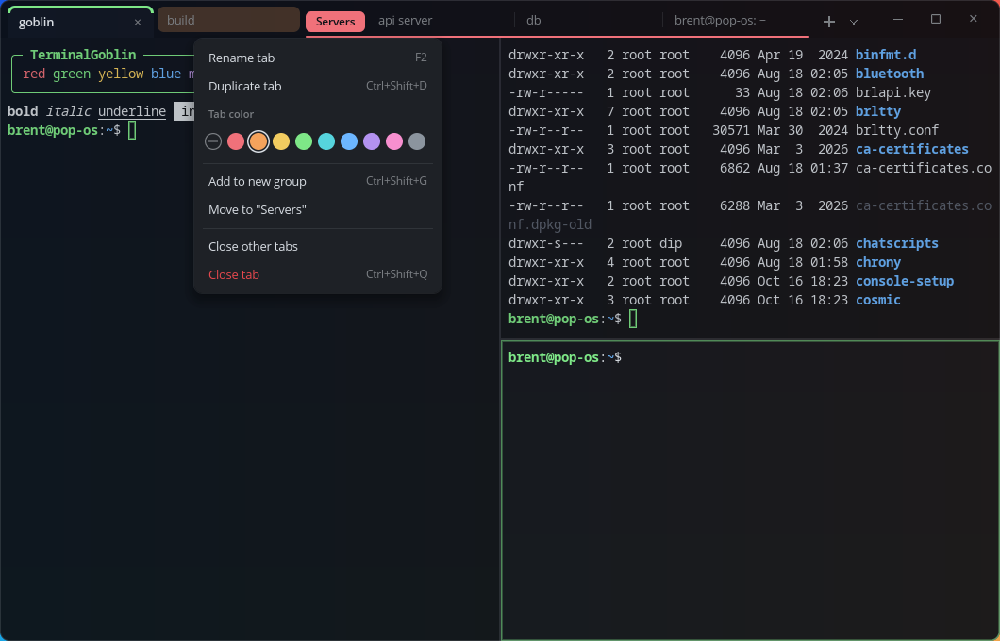

# TerminalGoblin

A tabbed, splittable, GPU-rendered terminal for Linux/Wayland, inspired by Windows Terminal. Written in Rust.



## Features

- **Multiple shells**: profiles are auto-detected from `/etc/shells` (bash, fish, zsh, ...) or defined in the config. Pick one from the `▾` menu or with `Ctrl+Shift+1..5`.
- **Tabs**: tabs live in the titlebar. You can rename them (double-click, `Ctrl+Shift+R`), give them colors, reorder them by dragging, duplicate them, and close them with a middle-click.
- **Tab groups**: named, colored groups of tabs, like a browser's. Click a group's chip to collapse or expand it, and double-click it to rename it.
- **Several tabs at once**: drag a tab down onto a pane (the half it will land in is highlighted) or choose "Show beside/below current tab" from its menu. Its terminal joins the current tab as a split and keeps the tab's name and color, shown in a slim header on each pane. "Move to new tab" (`Alt+Shift+N`) turns a pane back into a tab with that name and color.
- **Splits**: split panes right or down, move focus between them with the keyboard, resize them by dragging the divider or with the keyboard, and zoom a pane to fill the tab.
- **Settings window** (`Ctrl+,`): change colors, fonts, text size, opacity, blur, padding, pane headers, cursor and more, with every change applied live. The **Keybindings** page lets you click any shortcut and press new keys to rebind it, add or remove shortcuts, and reset one action or all of them. Everything is saved to the config file with its comments intact.
- **Per-pane text size**: `Ctrl+=` / `Ctrl+-` / `Ctrl+Scroll` resize the text in a single pane; `Ctrl+0` resets it to the default.
- **Transparency**: set the opacity, change it live (`Ctrl+Shift+Scroll`), toggle it (`Ctrl+Shift+O`), and ask the compositor for blur.
- **Modern look**: client-side decorations with rounded corners, a frameless tab strip, context menus, toasts, and 8 built-in color schemes (Goblin, Campbell, One Half Dark, Tokyo Night, Catppuccin Mocha, Dracula, Nord, Gruvbox Dark).
- **The same font Claude Code renders in on COSMIC**: Noto Sans Mono 14px, cosmic-term's default. Box-drawing and block characters are drawn geometrically so borders always connect.
- **Kitty keyboard protocol**: programs can tell Shift+Enter from Enter, so Claude Code's Shift+Enter newline works.
- Plus: true color, mouse reporting, bracketed paste, the Wayland clipboard and primary selection, OSC 8 hyperlinks (Ctrl+click), and config hot-reload.

Built on [`alacritty_terminal`](https://crates.io/crates/alacritty_terminal) for terminal emulation, [`wgpu`](https://wgpu.rs) for rendering, [`cosmic-text`](https://crates.io/crates/cosmic-text) for font shaping and [`winit`](https://crates.io/crates/winit) for Wayland windowing. There are no C library build dependencies.

## Install

Requires a Rust toolchain (`rustup`) and a Vulkan- or GL-capable GPU driver.

```sh
./install.sh            # builds a release binary and installs it to ~/.local
```

Or just run it from the checkout:

```sh
cargo run --release
```

## Keybindings

| Action | Keys |
| --- | --- |
| New tab (default profile) | `Ctrl+Shift+T` |
| New tab menu (profiles) | `Ctrl+Shift+Space` |
| New tab with profile N | `Ctrl+Shift+1..5` |
| Duplicate tab | `Ctrl+Shift+D` |
| Close pane / close tab | `Ctrl+Shift+W` / `Ctrl+Shift+Q` |
| Next / previous tab | `Ctrl+Tab` / `Ctrl+Shift+Tab` (or `Ctrl+PgDn` / `Ctrl+PgUp`) |
| Go to tab N | `Ctrl+Alt+1..9` |
| Move tab left / right | `Ctrl+Shift+PgUp` / `Ctrl+Shift+PgDn` |
| Rename tab | `Ctrl+Shift+R` or double-click |
| Split right / down / auto | `Alt+Shift+=` / `Alt+Shift+-` / `Alt+Shift+D` |
| Move focus between panes | `Alt+Arrow` (passed to the program when there's no pane that way) |
| Resize pane | `Alt+Shift+Arrow` (passed through when the tab isn't split) |
| Zoom pane | `Alt+Shift+Z` |
| Move pane to its own tab | `Alt+Shift+N` |
| Rename pane | `Alt+Shift+R`, or double-click its header |
| New group from tab / ungroup | `Ctrl+Shift+G` / `Ctrl+Shift+U` |
| Copy / paste | `Ctrl+Shift+C` / `Ctrl+Shift+V` |
| Select all | `Ctrl+Shift+A` |
| Scroll | `Shift+PgUp/PgDn`, `Ctrl+Shift+Up/Down`, `Ctrl+Shift+Home/End` |
| Clear scrollback | `Ctrl+Shift+K` |
| Pane text size | `Ctrl+=` / `Ctrl+-` / `Ctrl+0`, or `Ctrl+Scroll` (per pane) |
| Opacity | `Ctrl+Shift+Scroll`, `Ctrl+Shift+Alt+Up/Down`; toggle with `Ctrl+Shift+O` |
| Next color scheme | `Ctrl+Shift+S` |
| Fullscreen | `F11` |
| Settings window / reload config file | `Ctrl+,` / `Ctrl+Shift+,` |

Mouse:
- Drag to select. Double-click selects a word, triple-click a line, and Alt+drag a block. Shift+click extends the selection.
- Middle-click pastes the primary selection. Right-click opens the context menu.
- Scroll over the tab bar to switch tabs. Right-click a tab or group for its menu.
- Drag a tab onto a pane to show it there. Right-click a pane header to recolor it, and middle-click the header to close the pane.

## Configuration

Most options can be changed in the settings window (`Ctrl+,`), which writes them here. The config file is `~/.config/terminalgoblin/config.toml`. Set `$TERMINALGOBLIN_CONFIG` to use a different file. It is created, with comments, on first run, and saved changes apply immediately.

```toml
font_family = "Noto Sans Mono"
font_size = 14.0
color_scheme = "Goblin"
opacity = 0.94
blur = true
decorations = "client"      # or "system" for compositor decorations
pane_headers = "auto"       # "auto" (when a pane has a name/color), "always" or "never"
default_profile = "Fish"

[[profiles]]
name = "Fish"
command = "/usr/bin/fish"
tab_color = "#7ee787"

[keybindings]
"ctrl+t" = "new_tab"
"ctrl+shift+t" = "unbound"
```

See the generated file for every option, every action name, and a template for custom color schemes.

## Development

```sh
cargo test
cargo clippy
# Render a sample layout offscreen to a PNG (useful for checking visual changes):
cargo run -- --demo --screenshot /tmp/shot.png
```

| Module | Purpose |
| --- | --- |
| `app.rs` | Window, state and all input handling |
| `draw.rs` | Builds each frame: chrome, tabs, panes, menus |
| `settings.rs` | The settings window and keybinding editor |
| `renderer.rs`, `shader.wgsl` | One instanced wgpu pipeline for rounded rects, shadows and glyphs |
| `text.rs` | Font metrics, shaping, glyph atlas, built-in box drawing |
| `pane.rs` | A terminal: `alacritty_terminal::Term` plus its PTY thread |
| `layout.rs` | Split tree, divider dragging, directional focus |
| `workspace.rs` | Tabs, groups and their invariants |
| `input.rs` | Key/mouse encoding (legacy and kitty protocol) |
| `config.rs`, `theme.rs` | Config file, profiles, keybindings, color schemes |
